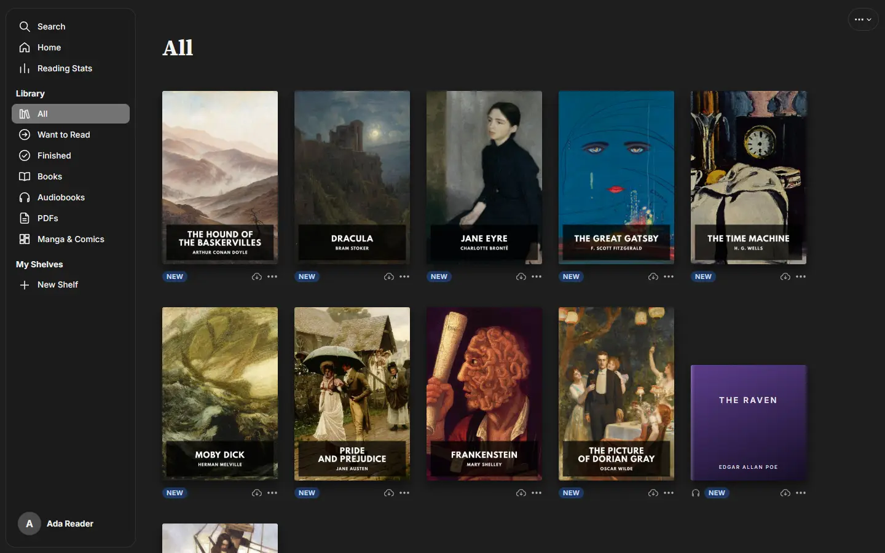
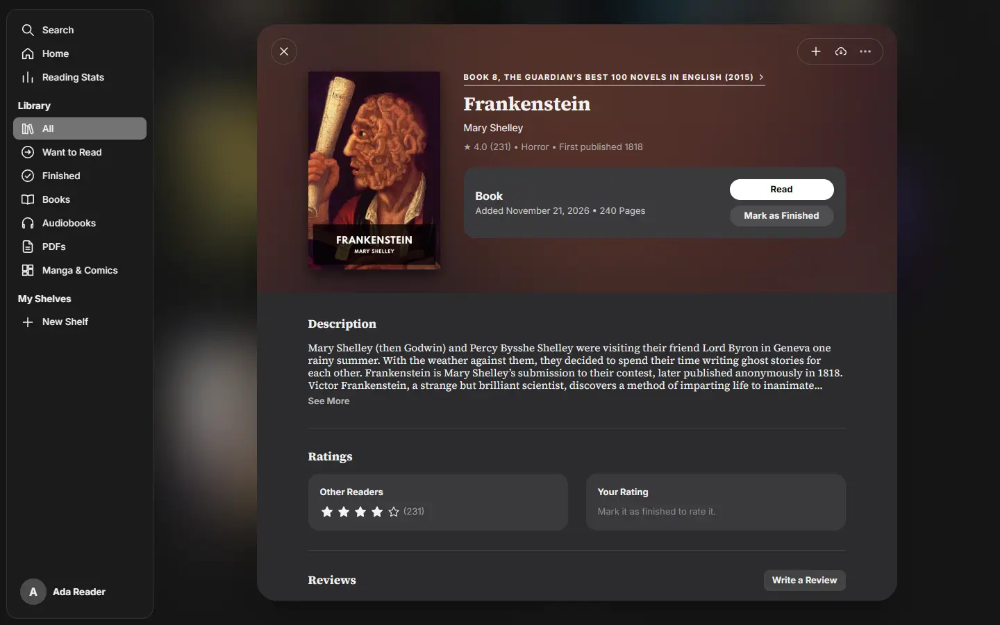
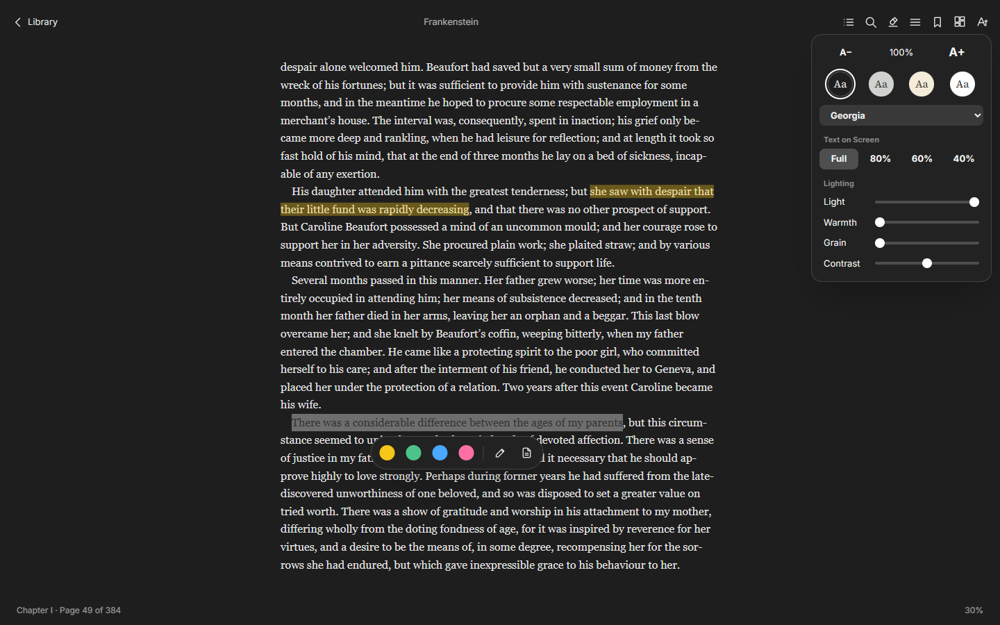
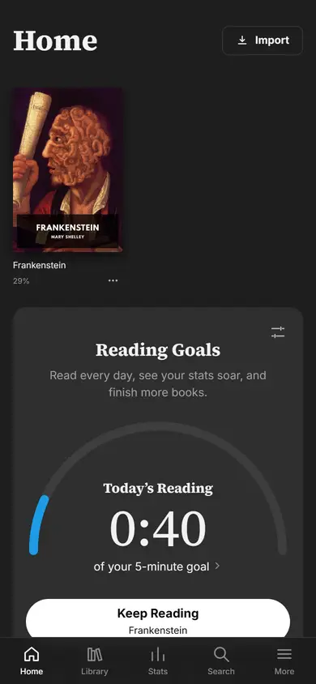

<div align="center">


# Sonnet

A self-hosted library and reader for ebooks, audiobooks, PDFs and manga.



</div>

Sonnet is one Next.js app with one SQLite file. Import your files and read or listen in the
browser, on any device, with progress kept on your own server.

## Features

- **Reads everything in the browser.** EPUB, PDF, CBZ and plain text, plus M4B, MP3, M4A, FLAC,
  OGG, Opus and WAV audiobooks. Multi-file audiobooks merge into one book with chapters.
- **A reader with the usual tools.** Paged or scrolling, right-to-left for manga, dark, sepia and
  light themes, bookmarks, highlights, search and a table of contents.
- **Metadata without API keys.** Covers, ratings, genres and series come from Open Library,
  Wikidata, Audible's public catalogue and AniList.
- **Goals and stats.** Daily and yearly goals, streaks, and charts of reading time.
- **Profiles and families.** One sign-in holds up to 8 profiles, each with its own shelves,
  progress and optional PIN. Accounts that share a family code see each other's shared shelves,
  recommendations and reviews.
- **Offline.** Installs to a phone or tablet's home screen, keeps chosen books on the device, and
  sends progress made offline when the server is back.

<table>
  <tr>
    <td></td>
    <td></td>
  </tr>
  <tr>
    <td></td>
    <td></td>
  </tr>
  <tr>
    <td></td>
    <td align="center"></td>
  </tr>
</table>

## Run

With Docker:

```
docker compose up --build
```

Or with Node 24 (the app uses the built-in `node:sqlite`):

```
npm install
npm run build
npm start
```

Open http://localhost:3000. The first account created becomes the admin. Other people create
their own accounts from the sign-in page until the admin turns that off under
Settings → Account.

Offline reading and installing to a home screen only work over HTTPS or on localhost, so put the
server behind a reverse proxy such as Caddy, or Tailscale, to use them from other devices.

## Desktop app

`desktop/` is a Windows and macOS app with the same interface. On first launch it asks where
your library is:

- **This computer.** The app runs its own copy of the server, reachable from this computer only,
  and keeps your books in its data folder. Nothing to set up, and it works offline.
- **A server.** Like Jellyfin's app, it connects to a Sonnet server by its address. It can also
  host one: the library on this computer, opened to the other devices on your network.

```
npm install      # the server's packages, which the app builds its copy from
cd desktop
npm install
npm start        # build the bundled server and run the app
npm run dist     # build the installer for the system you are on, into desktop/dist
```

An installer has to be built on the system it is for; the Desktop workflow on GitHub builds
them all when a `v*` tag is pushed. The installers are not code-signed, so Windows and macOS
warn on first open.

## Configuration

| Variable | Default | Holds |
| --- | --- | --- |
| `DATA_DIR` | `data/` | `library.db` (accounts, shelves, ratings, progress, reading time) and cover images |
| `LIBRARY_DIR` | `library/` | the imported book and audio files |
| `MAX_UPLOAD_MB` | `2048` | the largest file that can be imported |

Back up both folders. Settings → Library → Download Backup (admin) gives one zip of the database
and covers, and Restore puts one back. The book files in `library/` are not in it and are copied
by hand.

Imports are sent in 64 MB pieces, so large audiobooks upload through proxies that cap request
size, such as Cloudflare's free tunnel. Importing a file that is already there is skipped, and
Tidy Now re-files older books with the current rules.

## How it behaves

**Passwords.** The server sends no email. "Forgot password?" creates an 8-digit code, valid for
30 minutes, that the admin sees under Settings → Account and that is printed to the server log
(`Password reset code for …`). An admin who is locked out reads it from the log. The admin can
also set anyone's password. Eight wrong passwords lock an account for 15 minutes.

**What is shared.** Books are shared by everyone on the server. Shelves, ratings, progress,
bookmarks, highlights, goals, reading time and any details a person edits (title, author,
description, series, tags) belong to that person's profile. Signing in with the account password
always opens the account's own profile.

**Families.** Every account has a six-digit family code (Settings → Account). Someone who enters
it when creating their account, or in their own settings, joins that family. Shared shelves,
recommendations and the "what others are reading" list on Home stay inside a family. A profile
can turn off sharing its reading.

**Search.** A new profile sees what is new and trending. Once it has started, finished, rated or
wanted three books with a known genre, the rows follow its favourite genres and author.

**Content.** Adult manga is never shown: AniList flags it and it is always excluded. Books are
not filtered, and neither is anything you upload. Reviews are written by the people on the
server and stored in its database.

## Development

```
npm run dev
npm test
```

`deploy.sh` is the script I use to push to my own Proxmox container:
`DEPLOY_HOST=root@your-proxmox-host ./deploy.sh` (`DEPLOY_CT` picks the container, default 105).

## License

[AGPL-3.0](LICENSE) © Caleb Livingston
