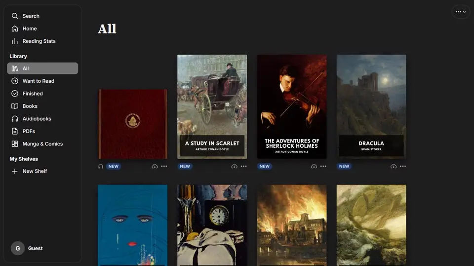
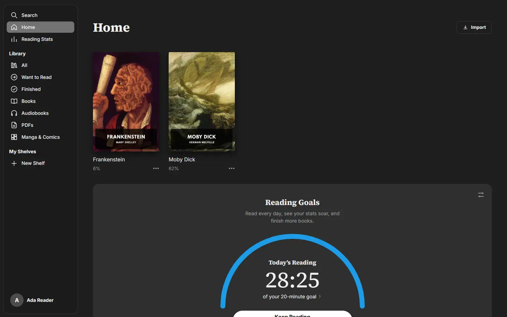
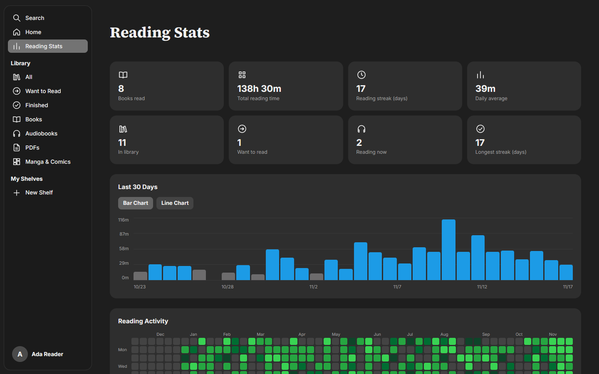
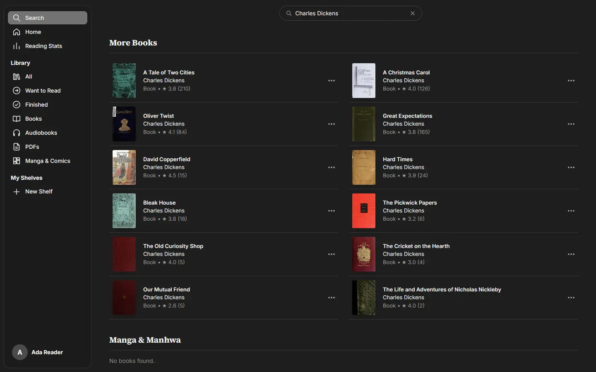

<div align="center">


# Sonnet

A self-hosted library and reader for ebooks, audiobooks, PDFs and manga.



</div>

Sonnet is one Next.js app with one SQLite file, built the way Jellyfin is: a server that holds
the library, and a browser or the Sonnet app on any device to read and listen with. Progress is
kept on your own server.

**[Live demo](https://sonnet-demo.clivingston.dev)** ·
**[Website](https://clivingston33.github.io/sonnet/)** ·
**[Docs](https://clivingston33.github.io/sonnet/docs.html)** ·
**[Download](https://clivingston33.github.io/sonnet/download.html)**

## Features

- **Reads everything in the browser.** EPUB, PDF, CBZ and plain text, plus M4B, MP3, M4A, FLAC,
  OGG, Opus and WAV audiobooks. Multi-file audiobooks merge into one book with chapters.
- **A reader with the usual tools.** Paged or scrolling, right-to-left for manga, dark, sepia and
  light themes, bookmarks, highlights, search and a table of contents.
- **Metadata without API keys.** Covers, ratings, genres and series come from Open Library,
  Wikidata, Audible's public catalogue and AniList.
- **Goals and stats.** Daily and yearly goals, streaks, and charts of reading time.
- **Profiles and families.** One sign-in holds up to 8 profiles, each with its own shelves,
  progress and optional PIN. Accounts that share a family code see each other's shared shelves,
  recommendations and reviews.
- **Offline.** Installs to a phone or tablet's home screen, keeps chosen books on the device, and
  sends progress made offline when the server is back.

<table>
  <tr>
    <td></td>
    <td></td>
  </tr>
  <tr>
    <td></td>
    <td></td>
  </tr>
  <tr>
    <td></td>
    <td align="center"></td>
  </tr>
</table>

## Run

With Docker, from the folder that should hold the library:

```
docker run -d --name sonnet --restart unless-stopped -p 3000:3000 -v ./data:/data -v ./library:/library ghcr.io/clivingston33/sonnet
```

Or from a clone, `docker compose up -d` (add `--build` to build this source instead of pulling).

Or with Node 24 (the app uses the built-in `node:sqlite`):

```
npm install
npm run build
npm start
```

Open http://localhost:3000. The first account created is the admin's, and setup follows: the
folders your books are in, then who else may use the library. People sign themselves up, joining
a family with its six-digit code; the admin can turn that off under Settings → Account and add
each person there instead.

Offline reading and installing to a home screen only work over HTTPS or on localhost, so put the
server behind a reverse proxy such as Caddy, or Tailscale, to use them from other devices.

## Library folders

Settings → Library (admin) lists the folders on the server's own disk that make up the library.
Sonnet reads the files where they are and never changes, moves or deletes them. It looks for new
files when a folder is added, on Scan Now, and when someone opens the library after 15 minutes.

- Removing a book takes it out of the library; its file stays in the folder and is not picked up
  again. Removing the folder and adding it back brings everything in it back.
- With Docker, mount the folders into the container (`-v /mnt/books:/books:ro`) and add the path
  inside it (`/books`).
- Files can still be uploaded from any device (Import). Those are copied into `LIBRARY_DIR`.
- A file deleted from a folder keeps its book until the book is removed in Sonnet.

## Desktop apps

`desktop/` builds two apps for Windows and macOS, as Jellyfin has a server and a player:

- **Sonnet Server** runs the library for a household from the system tray, on port 38916, for
  every device on the network. It opens its setup in your browser the first time.
- **Sonnet** shows a library in its own window. It lists the servers it finds on the network,
  takes an address for any other, and can instead keep a private library on this computer with
  nothing to set up ("Use This Computer"), or host that library for the network.

Servers answer a broadcast on UDP port 38918, which is how the app finds them; in Docker that
needs host networking, and typing the address always works.

```
npm install            # the server's packages, which the apps build their copy from
cd desktop
npm install
npm start              # build the bundled server and run Sonnet
npm run start:server   # ... or Sonnet Server
npm run dist           # both installers for the system you are on: desktop/dist and desktop/dist/server
```

An installer has to be built on the system it is for; the Desktop workflow on GitHub builds
them all when a `v*` tag is pushed. The installers are not code-signed, so Windows and macOS
warn on first open.

## Configuration

| Variable | Default | Holds |
| --- | --- | --- |
| `DATA_DIR` | `data/` | `library.db` (accounts, shelves, ratings, progress, reading time) and cover images |
| `LIBRARY_DIR` | `library/` | the uploaded book and audio files |
| `MAX_UPLOAD_MB` | `2048` | the largest file that can be imported |

Back up both folders. Settings → Library → Download Backup (admin) gives one zip of the database
and covers, and Restore puts one back. The book files are not in it: copy `library/` by hand, and
your library folders are yours to back up.

Imports are sent in 64 MB pieces, so large audiobooks upload through proxies that cap request
size, such as Cloudflare's free tunnel. Importing a file that is already there is skipped, and
Tidy Now re-files older books with the current rules.

## How it behaves

**Passwords.** The server sends no email. "Forgot password?" creates an 8-digit code, valid for
30 minutes, that the admin sees under Settings → Account and that is printed to the server log
(`Password reset code for …`). An admin who is locked out reads it from the log. The admin can
also set anyone's password. Eight wrong passwords lock an account for 15 minutes.

**What is shared.** Books are shared by everyone on the server. Shelves, ratings, progress,
bookmarks, highlights, goals, reading time and any details a person edits (title, author,
description, series, tags) belong to that person's profile. Signing in with the account password
always opens the account's own profile.

**Families.** Every account has a six-digit family code (Settings → Account). Someone who enters
it when creating their account, or in their own settings, joins that family. Shared shelves,
recommendations and the "what others are reading" list on Home stay inside a family. A profile
can turn off sharing its reading.

**Search.** A new profile sees what is new and trending. Once it has started, finished, rated or
wanted three books with a known genre, the rows follow its favourite genres and author.

**Content.** Adult manga is never shown: AniList flags it and it is always excluded. Books are
not filtered, and neither is anything you upload. Reviews are written by the people on the
server and stored in its database.

## Development

```
npm run dev
npm test
```

`deploy.sh` is the script I use to push to my own Proxmox container:
`DEPLOY_HOST=root@your-proxmox-host ./deploy.sh` (`DEPLOY_CT` picks the container, default 105).

## License

[AGPL-3.0](LICENSE) © Caleb Livingston

The website's button animations are after [Amicro](https://amicro.dev) (MIT).
